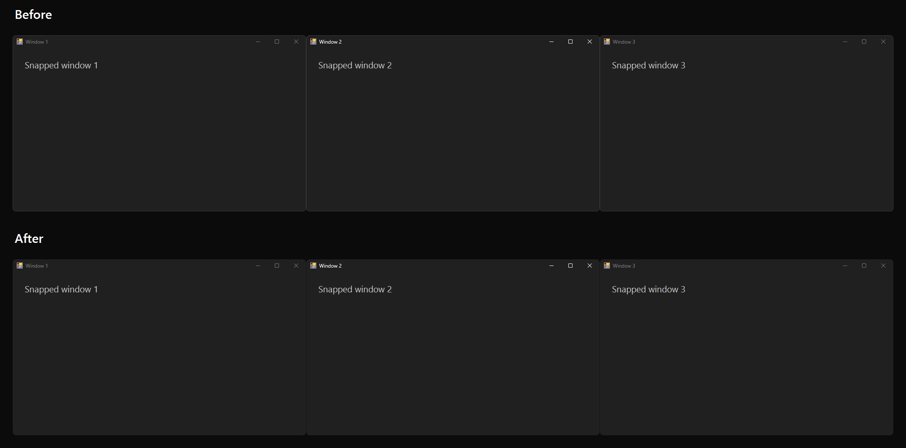
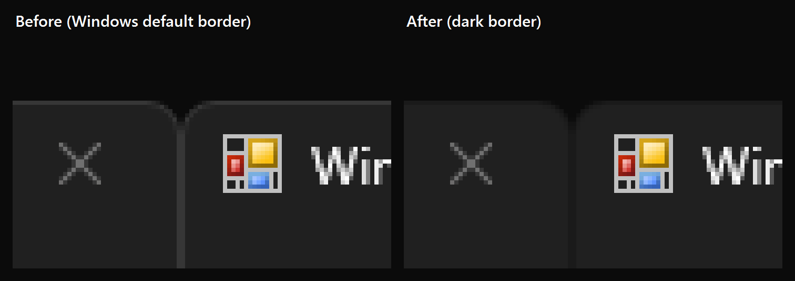

# Windows 11 Snap Layouts Dark Border Color

Make the thin light border around windows **dark** on Windows 11, including the bright lines you see between windows placed side by side with Snap Layouts.

**[Türkçe](README.tr.md)**

## The problem

Windows 11 draws a 1 px border around every window. On a dark setup it often shows up as a thin light/white line, and it is most visible when you snap two or three windows next to each other.

Windows has no setting for this. In my testing, turning on *"Show accent color on title bars and window borders"* and setting an accent color did not change it.

## Before / after



Zoomed in on the seam between two windows:



*Three plain demo windows placed edge to edge on Windows 11. The border is only 1 px wide, so the difference is subtle at normal size; the zoomed view shows it. On this machine the default border measured `#363636` and `#1a1a1a` after.*

## What this does

It sets the border color of every visible window with the documented `DWMWA_BORDER_COLOR` attribute (Windows 11, build 22000 or newer). A tiny hidden script re-applies the color once per second, so windows you open later are covered too. CPU use is negligible.

It starts by itself when you sign in, through a shortcut in your Startup folder.

## Install

1. Download **`Windows11-DarkBorderColor-Setup.cmd`** from the [Releases](../../releases) page.
2. Double-click it. When asked, type a color as `RRGGBB` and press Enter (Enter alone = `1a1a1a` dark gray, `000000` = black).
3. That's it. It is already running and will start at every sign-in.

You can also skip the question: `Windows11-DarkBorderColor-Setup.cmd -Color 222222`

> **Windows SmartScreen / antivirus:** the installer is an unsigned script, so Windows may warn you. The whole thing is plain text: open the `.cmd` in Notepad and read it, or read [`src/Setup.ps1`](src/Setup.ps1). It does nothing except what is listed under "What gets installed".

## Uninstall

Settings → Apps → Installed apps → **Windows 11 Snap Layouts Dark Border Color** → Uninstall.
Or run `Windows11-DarkBorderColor-Setup.cmd -Uninstall`. Window borders return to the Windows default.

## Change the color later

Edit `%LOCALAPPDATA%\Programs\Win11DarkBorderColor\color.txt` (one line, `RRGGBB`), then sign out and in again (or run the installer again).

## What gets installed

| What | Where |
|---|---|
| `darkborder.ps1`, `run-hidden.vbs`, `color.txt`, `Setup.ps1` | `%LOCALAPPDATA%\Programs\Win11DarkBorderColor\` |
| Startup shortcut `Win11DarkBorderColor.lnk` | your Startup folder (`shell:startup`) |
| Uninstall entry | `HKCU\Software\Microsoft\Windows\CurrentVersion\Uninstall\Win11DarkBorderColor` |

Nothing is installed system-wide and no administrator rights are needed. No network access, no telemetry.

## Limitations

- **Windows 11 only** (build 22000+). Windows 10 has no border color API; the installer refuses to run there.
- Apps that draw their own frame (some custom or Electron-style windows) are not affected.
- The Snap Layouts flyout and the snap preview overlay are drawn by Windows itself and are not recolored.
- The installer is not code-signed.

## Why a Startup shortcut and not the "Run" registry key?

On the machine this was developed on, Windows ignored newly added `HKCU\...\Run` entries (they never showed up in Task Manager's Startup tab). A Startup-folder shortcut worked, appears in Task Manager and Settings, and is easy to disable there.

## Build from source

```powershell
.\build.ps1
```

Produces `release\Windows11-DarkBorderColor-Setup.cmd` from `src\header.cmd` + `src\Setup.ps1`.

## Made with Claude Code

This project was built together with [Claude Code](https://claude.com/claude-code), Anthropic's AI coding assistant, and tested by the author on Windows 11 (build 26200). The scripts are short and plain text, so please read them before you run them.

## License

[MIT](LICENSE)
