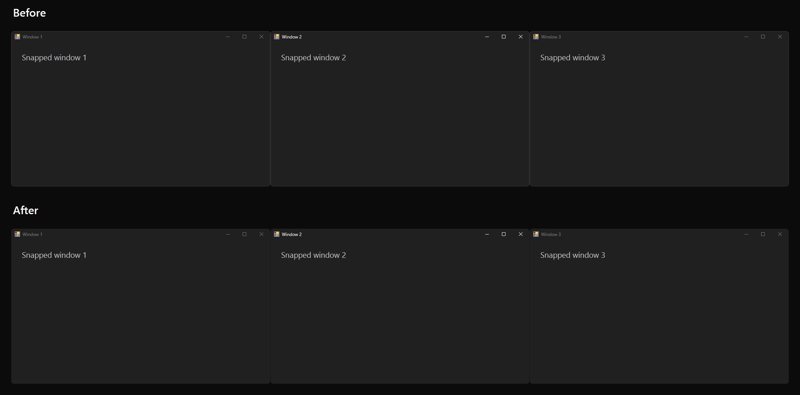
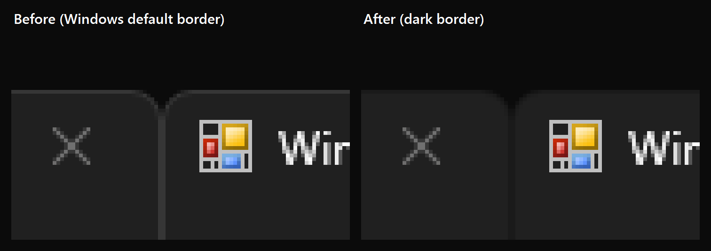

# Windows 11 Snap Layouts Dark Border Color

Windows 11'de pencerelerin etrafındaki ince açık renkli (beyaz) kenarlığı **koyu** yapar. Snap Layouts ile pencereleri yan yana dizince görünen parlak çizgiler dahil.

**[English](README.md)**

## Sorun

Windows 11 her pencerenin etrafına 1 piksellik bir kenarlık çizer. Koyu temada bu çoğu zaman ince açık/beyaz bir çizgi olarak görünür ve iki ya da üç pencereyi yan yana yerleştirdiğinde en çok göze batar.

Windows bunun için bir ayar sunmuyor. Denediğimde *"Başlık çubuklarında ve pencere kenarlıklarında vurgu rengini göster"* seçeneğini açmak ve vurgu rengini değiştirmek çizgiyi değiştirmedi.

## Önce / sonra



İki pencerenin birleştiği yere yakından bakış:



*Windows 11'de kenar kenara yerleştirilmiş üç sade demo pencere. Kenarlık yalnızca 1 piksel olduğu için normal boyutta fark ince görünür, yakınlaştırılmış görüntü farkı gösterir. Bu bilgisayarda varsayılan kenarlık `#363636`, sonrasında `#1a1a1a` ölçüldü.*

## Ne yapar?

Her görünür pencerenin kenarlık rengini belgelenmiş `DWMWA_BORDER_COLOR` özniteliğiyle ayarlar (Windows 11, derleme 22000 veya üstü). Küçük, gizli bir betik rengi saniyede bir yeniden uygular, böylece sonradan açtığın pencereler de boyanır. İşlemci kullanımı ihmal edilebilir düzeyde.

Oturum açtığında başlangıç klasöründeki bir kısayolla kendiliğinden başlar.

## Kurulum

1. [Releases](../../releases) sayfasından **`Windows11-DarkBorderColor-Setup.cmd`** dosyasını indir.
2. Çift tıkla. Renk sorulunca `RRGGBB` biçiminde yaz ve Enter'a bas (yalnızca Enter = `1a1a1a` koyu gri, `000000` = siyah).
3. Bitti. Hemen çalışmaya başlar ve her oturum açılışında kendiliğinden başlar.

Soruyu atlamak için: `Windows11-DarkBorderColor-Setup.cmd -Color 222222`

> **Windows SmartScreen / antivirüs:** kurulum dosyası imzasız bir betik olduğu için Windows uyarı verebilir. Her şey düz metin: `.cmd` dosyasını Not Defteri ile açıp okuyabilir ya da [`src/Setup.ps1`](src/Setup.ps1) dosyasına bakabilirsin. "Neler kurulur?" bölümünde yazanlardan başka bir şey yapmaz.

## Kaldırma

Ayarlar → Uygulamalar → Yüklü uygulamalar → **Windows 11 Snap Layouts Dark Border Color** → Kaldır.
Ya da `Windows11-DarkBorderColor-Setup.cmd -Uninstall` çalıştır. Kenarlıklar Windows varsayılanına döner.

## Rengi sonradan değiştirme

`%LOCALAPPDATA%\Programs\Win11DarkBorderColor\color.txt` dosyasını düzenle (tek satır, `RRGGBB`), sonra oturumu kapatıp aç (ya da kurulumu yeniden çalıştır).

## Neler kurulur?

| Ne | Nereye |
|---|---|
| `darkborder.ps1`, `run-hidden.vbs`, `color.txt`, `Setup.ps1` | `%LOCALAPPDATA%\Programs\Win11DarkBorderColor\` |
| Başlangıç kısayolu `Win11DarkBorderColor.lnk` | Başlangıç klasörün (`shell:startup`) |
| Kaldırma girişi | `HKCU\Software\Microsoft\Windows\CurrentVersion\Uninstall\Win11DarkBorderColor` |

Sisteme genel hiçbir şey kurulmaz, yönetici yetkisi gerekmez. Ağ erişimi ve veri toplama yok.

## Sınırlamalar

- **Yalnızca Windows 11** (derleme 22000+). Windows 10'da kenarlık rengi API'si yok, kurulum orada çalışmayı reddeder.
- Kendi çerçevesini çizen uygulamalar (bazı özel ya da Electron tarzı pencereler) etkilenmez.
- Snap Layouts paneli ve yerleştirme önizlemesini Windows kendisi çizer, bunların rengi değişmez.
- Kurulum dosyası kod imzalı değildir.

## Neden "Run" kaydı yerine Başlangıç klasörü kısayolu?

Bunun geliştirildiği bilgisayarda Windows, yeni eklenen `HKCU\...\Run` kayıtlarını görmezden geldi (Görev Yöneticisi'nin Başlangıç sekmesinde hiç görünmediler). Başlangıç klasörü kısayolu çalıştı, Görev Yöneticisi ve Ayarlar'da görünüyor ve oradan kolayca kapatılabiliyor.

## Kaynaktan derleme

```powershell
.\build.ps1
```

`src\header.cmd` + `src\Setup.ps1` dosyalarından `release\Windows11-DarkBorderColor-Setup.cmd` üretir.

## Claude Code ile yapıldı

Bu proje, Anthropic'in yapay zekâ kodlama asistanı [Claude Code](https://claude.com/claude-code) ile birlikte geliştirildi ve yazar tarafından Windows 11'de (derleme 26200) denendi. Betikler kısa ve düz metin, çalıştırmadan önce okumanı öneririm.

## Lisans

[MIT](LICENSE)
